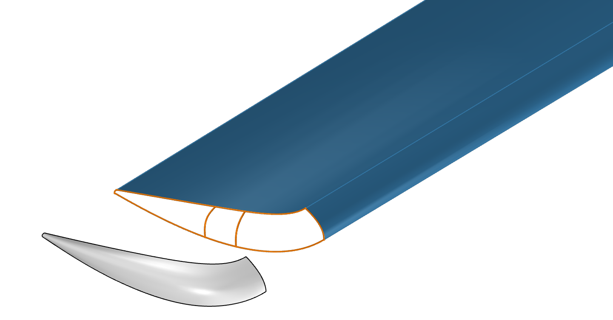

.. _introduction:

Overview
========

The **Geometry Modelling Library**, geoml, is intended to serve as the central geometry library for the German Aerospace Center (DLR) to bundle development efforts.

It extends OpenCASCADE Technology with advanced modelling functionalities such as Gordon surfaces or smooth blending and provides a framework for robust and persistent feature tracking and metadata annotation for parametric modelling.

Geoml is based on a stripped down version of the `TiGL library <https://github.com/DLR-SC/tigl>`_, extracting TiGL's purely geometric capabilities.

The source code of geoml is available on GitHub:
`github.com/DLR-SC/geoml <https://github.com/DLR-SC/geoml>`_.

Licence
-------

This project is licensed under the Apache License 2.0.

.. The table of contents is only shown in the navigation sidebar; the landing
   page itself shows the overview.

.. toctree::
   :maxdepth: 2
   :caption: Contents:
   :hidden:

   Overview <self>
   installation
   usage
   api
   examples
   genindex
