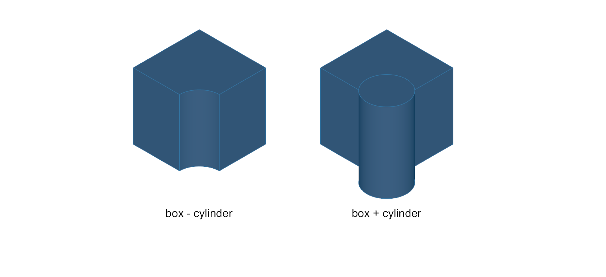
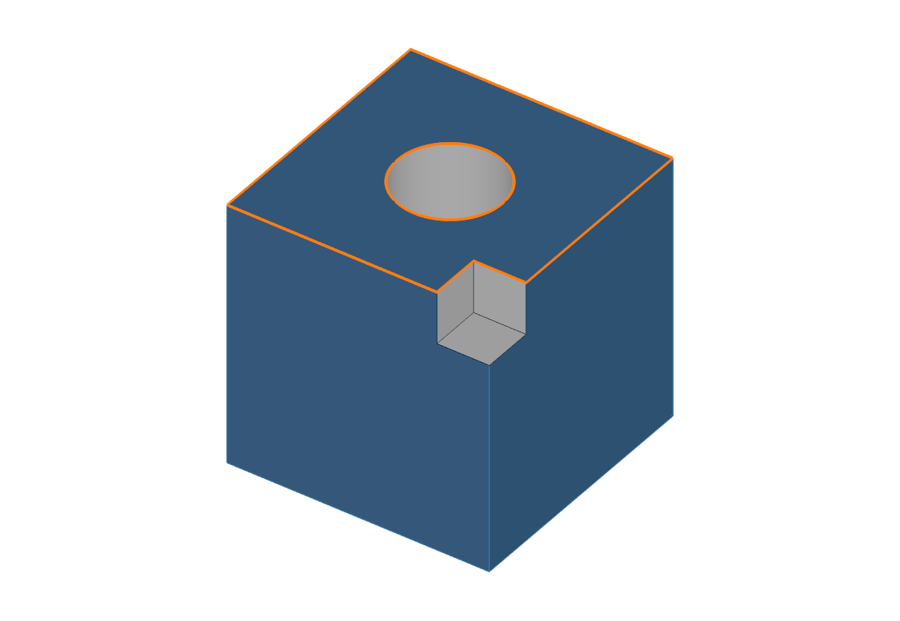

.. _python-examples:

Python Examples
===============

The Python bindings expose the C++ API through ``geoml.pygeoml``.

For more usage patterns, see the
`Python tests <https://github.com/DLR-SC/geoml/tree/main/tests/python>`_;
they can be used as additional application examples and as orientation for how
geoml is used in practice.

Curves and Shapes
-----------------

.. literalinclude:: examples/python_curve_example.py
   :language: python
   :caption: Interpolate a curve and wrap it as a Shape

.. figure:: _static/examples/python_curve_example.png
   :alt: Result of python curve example
   :width: 500px
   :align: center

   The interpolated B-spline curve (blue) with its control points (orange) and its meta tag.

Blend Curve
-----------

.. literalinclude:: examples/python_blend_curve_example.py
   :language: python
   :caption: Create a blend curve between two edges

.. figure:: _static/examples/blend_curve_example.png
   :alt: Result of blend curve example
   :width: 500px
   :align: center

   The blend curve (blue) connects the two input curves (grey) with G1 continuity. The labels show the meta tags of the curves.

Curve Network Surface
---------------------

.. literalinclude:: examples/python_curve_network_example.py
   :language: python
   :caption: Interpolate a surface through a curve network

.. figure:: _static/examples/curve_network_example.png
   :alt: Result of curve network example
   :width: 700px
   :align: center

   Left: the curve network (blue) with the control points of its curves. Right: the resulting Gordon surface (blue) with its control points (orange).

Modelling Operations
--------------------

.. literalinclude:: examples/python_modeling_example.py
   :language: python
   :caption: Create and combine history-aware shapes

   Left: the box with the cylinder subtracted. Right: the union of box and cylinder.

Selecting, Tracking and Tagging Subshapes
-----------------------------------------

The following examples are the Python versions of the C++ examples in
:ref:`shapes-examples`, which also explains the concepts of predicates,
history, meta tags and tag tracks. Each example checks its results with
``assert`` and prints ``OK``.

Compared to C++, note the following:

* Predicates are combined with ``&`` (and), ``|`` (or) and ``~`` (not).
* Python functions cannot be used as predicates. To select subshapes by
  geometric properties, find them with pythonocc and combine
  ``pygeoml.is_same`` predicates, as the helper functions in the examples do.
* Iterate over a selection with ``for i in range(selection.size())`` and
  ``selection[i]``. Iterating over a ``Shape`` directly does not stop at the
  last subshape.
* OpenCASCADE shapes created with pythonocc can be wrapped with
  ``pygeoml.Shape(topods_shape)``, and ``shape.shape()`` returns the wrapped
  OpenCASCADE shape.

Selecting subshapes with predicates
^^^^^^^^^^^^^^^^^^^^^^^^^^^^^^^^^^^

.. literalinclude:: examples/python_shape_selection_example.py
   :language: python
   :caption: Select subshapes with predicates

.. figure:: _static/examples/shape_selection_example.png
   :alt: Result of shape selection example
   :width: 500px
   :align: center

   The box with the selected edges of the top face and the vertices of the side faces on the bottom face (orange).

Tracking subshapes through modelling operations
^^^^^^^^^^^^^^^^^^^^^^^^^^^^^^^^^^^^^^^^^^^^^^^

.. literalinclude:: examples/python_shape_history_example.py
   :language: python
   :caption: Track subshapes with history predicates

   The result after both modelling steps: faces that descend from the drill or the corner tool (grey) and the edges of the face that descends from the original top face (orange).

Tagging subshapes and tag tracks
^^^^^^^^^^^^^^^^^^^^^^^^^^^^^^^^

.. literalinclude:: examples/python_shape_tagging_example.py
   :language: python
   :caption: Tag subshapes and use tag tracks

.. figure:: _static/examples/shape_tagging_example.png
   :alt: Result of shape tagging example
   :width: 500px
   :align: center

   The result after step 2 with its tags: the face tagged "bore" (grey) and the face tagged "top" with its edges (orange).
