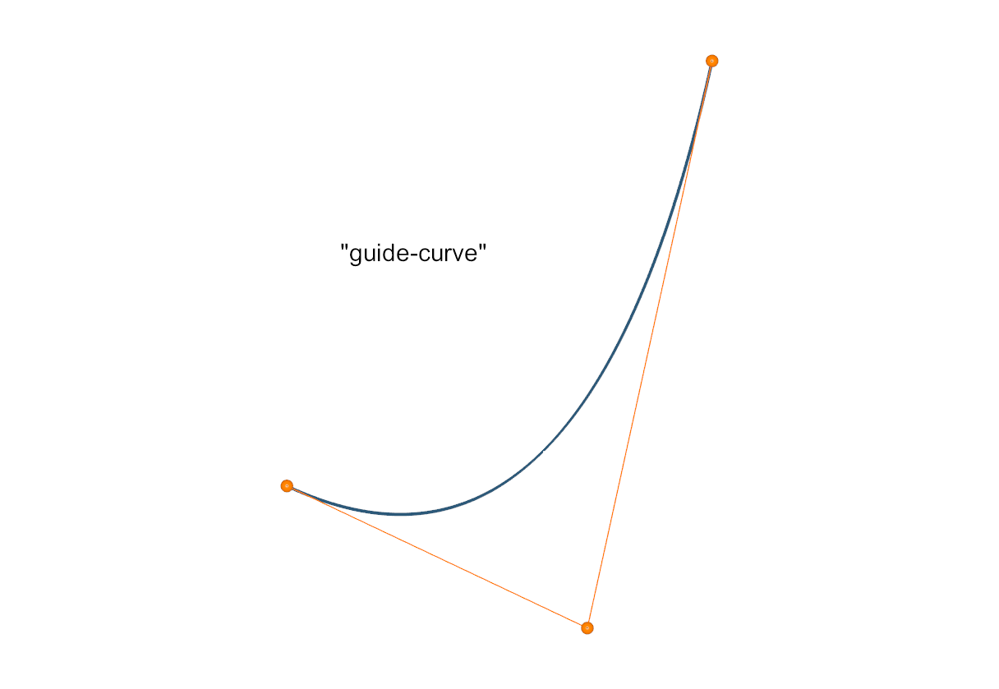
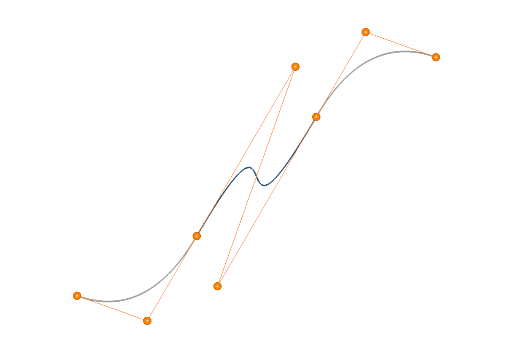
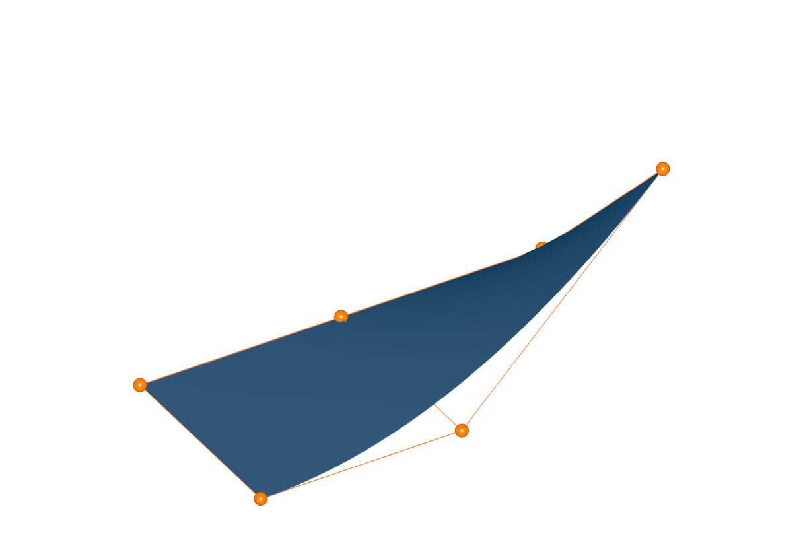
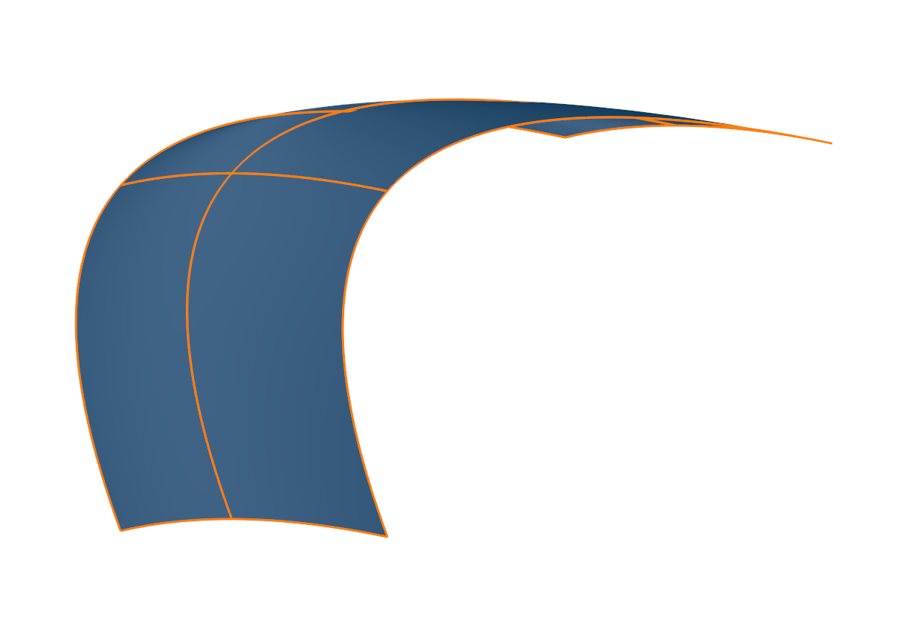
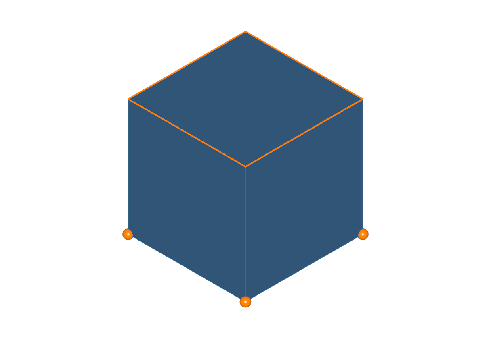
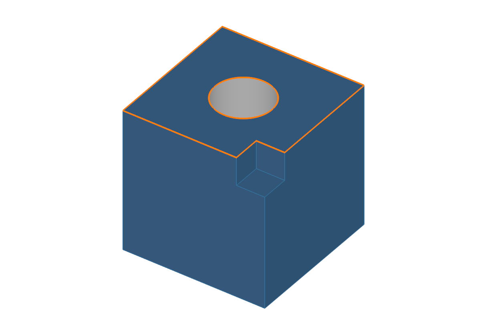

.. _python-examples:

Python Examples
===============

The Python bindings expose the C++ API through ``geoml.pygeoml``.

For more usage patterns, see the
`Python tests <https://github.com/DLR-SC/geoml/tree/main/tests/python>`_;
they can be used as additional application examples and as orientation for how
geoml is used in practice.

Curves
------

This section gives a short introduction to the curve functionality and a few
small examples. For the full API reference see :ref:`curves-api` in the
API section.

Quick example
^^^^^^^^^^^^^

The following minimal example interpolates a small set of points with a
B-spline curve, converts it to an edge, wraps it in a ``Shape`` and tags it.

.. literalinclude:: examples/python_curve_example.py
   :language: python
   :caption: Interpolate a curve and wrap it as a Shape

   The interpolated B-spline curve (blue) with its control points (orange) and its meta tag.

Blend curve example
^^^^^^^^^^^^^^^^^^^

Blend curves connect two input edges with a requested geometric continuity at
each end. The following example creates two interpolated curves, converts them
to edges and builds a transition curve between them.

.. literalinclude:: examples/python_blend_curve_example.py
   :language: python
   :caption: Create a blend curve between two edges

   The blend curve (blue) connects the two input curves (grey) with G1 continuity. The labels show the meta tags of the curves.

Surfaces
--------

This section gives a short introduction to surface functionality and a few
small examples. For the full API reference see :ref:`surfaces-api` in the
API section.

Quick example
^^^^^^^^^^^^^

The following minimal example shows how to create a simple NURBS surface
from a small control point grid.

.. literalinclude:: examples/python_surface_example.py
   :language: python
   :caption: Create a simple NURBS surface

   The NURBS surface (blue) with its control points (orange).

Curve network example
^^^^^^^^^^^^^^^^^^^^^

``interpolate_curve_network`` creates a Gordon surface from two sets of
crossing curves. Each ``u`` curve must intersect each ``v`` curve within the
given tolerance.

.. literalinclude:: examples/python_curve_network_example.py
   :language: python
   :caption: Interpolate a surface through a curve network

   Left: the curve network (blue) with the control points of its curves. Right: the resulting Gordon surface (blue) with its control points (orange).

Selecting, Tracking and Tagging Subshapes
-----------------------------------------

The following examples are the Python versions of the C++ examples in
:ref:`shapes-examples`.

Concepts
^^^^^^^^

The concepts of predicates, history, meta tags and tag tracks are explained in
:ref:`shapes-examples` and :ref:`robust-referencing`. Compared to C++, note
the following:

* Predicates are combined with ``&`` (and), ``|`` (or) and ``~`` (not).
* Python functions cannot be used as predicates. To select subshapes by
  geometric properties, find them with pythonocc and combine
  ``pygeoml.is_same`` predicates, as the helper functions in the examples do.
* Iterate over a selection with ``for i in range(selection.size())`` and
  ``selection[i]``. Iterating over a ``Shape`` directly does not stop at the
  last subshape.
* OpenCASCADE shapes created with pythonocc can be wrapped with
  ``pygeoml.Shape(topods_shape)``, and ``shape.shape()`` returns the wrapped
  OpenCASCADE shape.

Running the examples
^^^^^^^^^^^^^^^^^^^^

Each example is a complete script. It checks its results with ``assert`` and
prints ``OK``. Run it with the Python of an environment in which geoml is
installed, see :ref:`installation`.

Selecting subshapes with predicates
^^^^^^^^^^^^^^^^^^^^^^^^^^^^^^^^^^^

.. literalinclude:: examples/python_shape_selection_example.py
   :language: python
   :caption: Select subshapes with predicates

   The box with the selected edges of the top face and the vertices of the side faces on the bottom face (orange).

Tracking subshapes through modelling operations
^^^^^^^^^^^^^^^^^^^^^^^^^^^^^^^^^^^^^^^^^^^^^^^

.. literalinclude:: examples/python_shape_history_example.py
   :language: python
   :caption: Track subshapes with history predicates

.. figure:: _static/examples/shape_history_example.png
   :alt: Result of shape history example
   :width: 500px
   :align: center

   The result after both modelling steps: faces that descend from the drill or the corner tool (grey) and the edges of the face that descends from the original top face (orange).

Tagging subshapes and tag tracks
^^^^^^^^^^^^^^^^^^^^^^^^^^^^^^^^

.. literalinclude:: examples/python_shape_tagging_example.py
   :language: python
   :caption: Tag subshapes and use tag tracks

   The result after step 2 with its tags: the face tagged "bore" (grey) and the face tagged "top" with its edges (orange).
