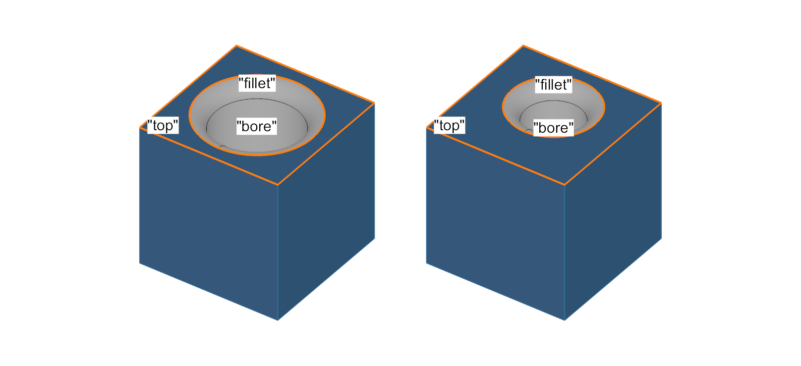
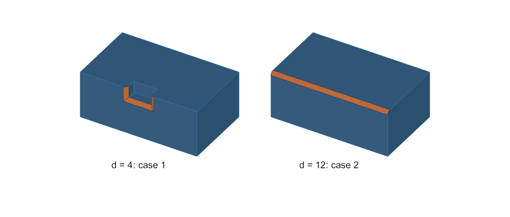

.. _robust-referencing:

Robust Referencing
==================

Why robust referencing matters
------------------------------

A parametric model is a sequence of modelling operations whose inputs depend
on parameters. Every time a parameter changes, the whole sequence is evaluated
again. Many operations need references to subshapes of intermediate results:
the edges to fillet, the face to attach the next feature to.

These references must point to the *right* subshape in every evaluation of
the model: the subshape that the **modelling intention** asks for. The
modelling intention has to be defined explicitly by the modeller. For some
parameter constellations the intention may ask for a different selection than
for others; the modeller then defines **cases** and a selection for each case
(see :ref:`selection-cases`).

Referencing a subshape by its index, for example "the third face of the
result", does not necessarily achieve this. The number and the order of the
subshapes may change when the topology changes, for example after a Boolean
operation, and the order can even change between program runs with the same
parameters. A model built on such references silently selects the wrong faces
as soon as the topology changes with a parameter change. This is known as the
*topological naming problem*.

geoml solves it by referencing subshapes by what they *are* rather than by
where they are stored:

* by their topological relations, using **topological predicates**,
* by their geometric properties, using **geometric predicates**,
* by their origin in earlier modelling steps, using **history predicates**,
* by names, using **meta tags** and **tag tracks**.

The role of ``geoml::Shape``
----------------------------

``geoml::Shape`` wraps an OpenCASCADE ``TopoDS_Shape``. In addition to the
geometry and topology it stores

* the direct topological subshapes, which are ``Shape`` objects themselves,
* the **history**: for every subshape, the subshapes of the inputs of the last
  modelling operation it originates from, and whether it was modified by that
  operation,
* **meta tags**: strings attached to a subshape,
* **tag tracks**: rules that re-apply a tag after the next modelling
  operations.

A ``Shape`` converts implicitly to and from a ``TopoDS_Shape``, so it can be
passed to OpenCASCADE functions directly. ``select_subshapes(predicate)``
returns all subshapes that satisfy a predicate, wrapped in a compound
``Shape``; ``unique_element()`` unwraps a selection with exactly one subshape.

A ``Shape`` constructed from a ``TopoDS_Shape``, and the shapes returned by the
primitives ``create_box`` and ``create_cylinder``, have no history. They are
the starting points of a model.

Operations that track history
-----------------------------

Only operations that take ``Shape`` objects and record the history of their
result can be followed with history predicates and tag tracks. Currently these
are:

.. list-table::
   :header-rows: 1
   :widths: 40 60

   * - Operation
     - Description
   * - ``boolean_subtract(shape, tool)``, ``shape - tool``
     - Subtracts ``tool`` from ``shape``
       (:ref:`Boolean Operations <boolean-ops-api>`).
   * - ``boolean_union(shape_1, shape_2)``, ``shape_1 + shape_2``
     - The union of two shapes
       (:ref:`Boolean Operations <boolean-ops-api>`).
   * - ``make_fillet(solid, edges, radius)``
     - Adds fillets to the given edges of a solid
       (:ref:`Utilities <utilities-api>`).

The list will be extended gradually. Other functions, such as ``translate``,
work on ``TopoDS_Shape`` and do not record history. Wrapping their result in a
``Shape`` starts a new history.

Concepts
--------

**Predicates** are functions that take a ``Shape`` and return a Boolean,
wrapped in a ``geoml::ShapePredicate``. They are combined with ``&&``, ``||``
and ``!`` (in Python with ``&``, ``|`` and ``~``). Type predicates such as
``is_face`` and topological predicates such as ``is_subshape_of`` and
``has_subshape_that`` select subshapes by their properties and relations.
Any callable ``bool(geoml::Shape const&)`` can be wrapped in a
``ShapePredicate``, for example to select faces by geometric properties.

**History predicates** select subshapes by their origin:

* ``is_descendent_of(s)``: originates from ``s``,
* ``is_modified_descendent_of(s)`` and ``is_unmodified_descendent_of(s)``:
  originates from ``s`` and was or was not modified on the way,
* the ``..._subshape_in(s)`` variants: originates from any subshape of ``s``,
  for example any face of a cutting tool.

They follow the history over any number of modelling steps; the optional
``max_depth`` argument limits the number of steps.

**Meta tags** are strings attached to a subshape with ``add_meta_tag`` or
``add_meta_tag_to_subshapes(predicate, tag)`` and selected with
``has_tag(tag)``. A modelling operation creates new subshapes, so meta tags
are not part of its result.

**Tag tracks** make tags persistent. A ``geoml::TagTrack`` consists of a tag,
a predicate and a number of modelling steps. Each history-tracking operation
passes the tag tracks of its inputs on to the result and tags all subshapes of
the result that satisfy the predicate, until the number of steps is used up.
Combined with a history predicate, a tag track names the descendents of a
subshape through the following modelling steps.

For the full API see :ref:`naming-choosing-api` and :ref:`predicates-api`.

Example
-------

The following parametric model drills a hole into a box and fillets the edge
where the hole meets the top face. The position and radius of the hole are
parameters.

* The top face and the drill wall are referenced in the *inputs*, where they
  are easy to find.
* The edge to fillet is found in the result of the first step with history
  predicates: it is the edge between the descendents of the top face and of
  the drill wall.
* The fillet face is the only face of the final part that does not descend
  from the drilled box.
* Tag tracks and a meta tag name the faces, so the user of ``make_part`` can
  select them by name.

None of these references depend on the number or order of the subshapes, so
they stay valid for all parameter values.

.. literalinclude:: examples/robust_referencing_example.cpp
   :language: cpp
   :caption: Robust references in a parametric model

   Two variants of the model with different hole positions and radii. The tags select
   the same faces in both: "top" (orange edges), "bore" and "fillet" (grey).

This model needs no case distinction: one selection follows the modelling
intention for all parameter values.

.. _selection-cases:

Selection cases
---------------

In general, a selection criterion :math:`L` consists of **cases** and a
**selection** for each case:

.. math::

   L = \bigvee_{i \in C} \left( \mathit{Case}_i \wedge \mathit{Selection}_i \right)

* :math:`\mathit{Case}_i` is a condition on the model. It can be formulated
  with any predicate, for example with history predicates ("the edge
  :math:`X` gets cut by the box :math:`B`") or directly with the parameters
  (":math:`d < 3`"). The cases must be *mutually exclusive and exhaustive*:
  for every parameter constellation exactly one case applies. The cases split
  the parameter space into equivalence classes, in each of which the modelling
  intention asks for the same selection.
* :math:`\mathit{Selection}_i` is the predicate that selects the subshapes
  the modelling intention asks for in case :math:`i`.

Because exactly one case applies, :math:`L` is the selection of that case. In
code, evaluate the cases as Booleans, check that exactly one of them applies
and select with its selection predicate:

.. code-block:: python

   cases = [(case_1, selection_1), (case_2, selection_2)]
   assert sum(case for case, _ in cases) == 1  # mutually exclusive and exhaustive
   L = next(selection for case, selection in cases if case)

The cases should follow the **modelling intention**, not the topology of the
result. Selections formulated with topological, geometric and history
predicates usually stay valid when the topology changes, so a new case is only
needed where the intention itself changes. Selecting by index or by other
topology-dependent properties instead forces a new case for every change of
the topology: the number of cases grows quickly with the number of parameters,
and the cases have to cover parameter ranges that are irrelevant for the
intention.

For example, "fillet what remains of the frontal upper edge :math:`X` after
cutting a notch into it at position :math:`d`" needs only one case for all
:math:`d`, with :math:`\mathit{Case}_1 = \mathit{true}`:

.. math::

   L = \mathit{is\_descendent\_of}(X)

Example with two cases
^^^^^^^^^^^^^^^^^^^^^^

A box :math:`B` of size 2, moved along the frontal upper edge :math:`X` of a
box by the parameter :math:`d`, is subtracted from the box. Depending on
:math:`d`, it cuts a notch into :math:`X` or misses the box. The modelling
intention is:

* Case 1, :math:`B` cuts :math:`X`: fillet the edges of the notch on the front
  face.
* Case 2, :math:`B` does not cut :math:`X`: fillet :math:`X`.

The cases are formulated with a history predicate: :math:`B` cuts :math:`X` if
the result contains a modified descendent of :math:`X`. They are mutually
exclusive and exhaustive. The selections use topological and history
predicates: the edges of the notch on the front face are the edges shared by
the front face and the faces that descend from :math:`B`.

.. literalinclude:: examples/selection_cases_example.cpp
   :language: cpp
   :caption: Selection cases in C++

.. literalinclude:: examples/python_selection_cases_example.py
   :language: python
   :caption: Selection cases in Python

   Left: :math:`d = 4`, case 1, :math:`B` cuts :math:`X` and the edges of the
   notch on the front face are filleted. Right: :math:`d = 12`, case 2,
   :math:`B` misses the box and :math:`X` is filleted. The fillet faces are
   shown in orange.

More examples are in :ref:`shapes-examples`.
